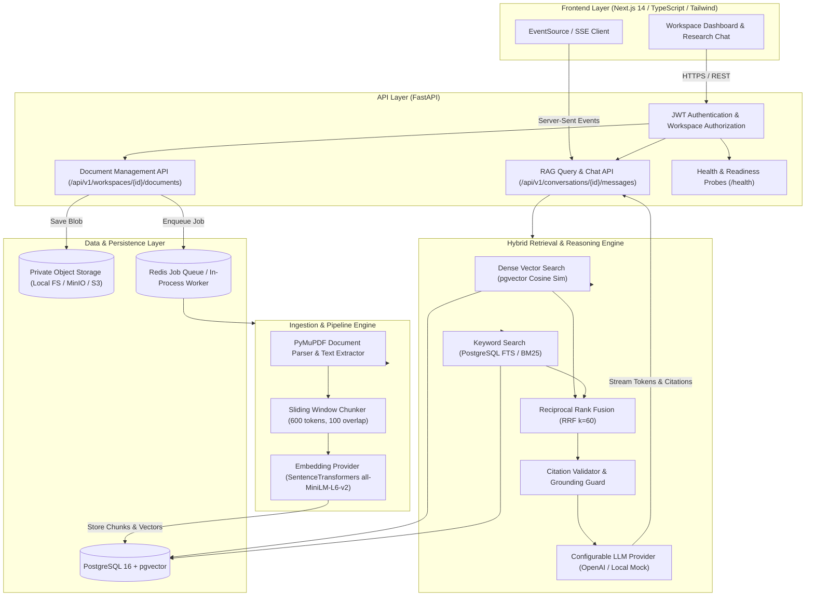

# ResearchPilot — Production-Grade AI Research Assistant with Source-Grounded Answers

[](https://github.com/24f2004729/researchpilot/actions)
[](https://fastapi.tiangolo.com)
[](https://nextjs.org)
[](https://github.com/pgvector/pgvector)
[](docs/portfolio/evaluation_report.md)
[](docs/portfolio/evaluation_report.md)
[](docs/portfolio/evaluation_report.md)
[](docs/portfolio/evaluation_report.md)
[](LICENSE)

> **ResearchPilot** is an enterprise-grade, portfolio-ready full-stack AI research assistant engineered for multi-document question answering across technical literature with verifiable source citations, hybrid search (dense vectors + full-text search fused via Reciprocal Rank Fusion), and honest abstention.

---

## 📑 Table of Contents
- [Executive Overview](#1-executive-overview)
- [System Architecture & Flow](#2-system-architecture--flow)
- [Key Engineering Differentiators](#3-key-engineering-differentiators-vs-standard-rag)
- [Measured Quantitative Benchmarks](#4-measured-quantitative-benchmarks)
- [Portfolio & Interview Pack](#5-portfolio--interview-pack)
- [Tech Stack](#6-tech-stack)
- [Quickstart & Local Setup](#7-quickstart--local-setup)
- [Running Automated Tests & Benchmarks](#8-running-automated-tests--benchmarks)
- [License](#9-license)

---

## 1. Executive Overview

Researchers and engineers querying complex technical papers face two major points of failure with standard LLM tools:
1. **Semantic search alone fails on exact parameters**: Pure vector embeddings capture broad concepts but fail on technical parameters (`150ms`, `32MB`, `efSearch`).
2. **LLM hallucinations invent citations**: Standard models generate plausible-sounding claims citing non-existent pages or fabricated passages.

**ResearchPilot solves this** through:
- **PyMuPDF Document Ingestion**: Fast PDF and text parsing that preserves page numbers, section headers, and document structure.
- **Sliding-Window Token Chunking**: Configurable target sizes (500–800 tokens) with bounded 100-token overlap.
- **Hybrid Search via Reciprocal Rank Fusion (RRF $k=60$)**: Mathematical rank fusion combining dense semantic similarity (pgvector) with exact keyword matching (PostgreSQL FTS / BM25).
- **Two-Stage Citation Guard**: Validates that all citations reference actual database chunks and verifies verbatim quote agreement in source text.
- **Honest Abstention Engine**: Distinguishes answerable from unanswerable questions, abstaining cleanly rather than hallucinating facts.
- **Multi-Tenant Workspace Isolation**: Database-level workspace scoping guarantees zero cross-tenant data leakage.

---

## 2. System Architecture & Flow



---

## 3. Key Engineering Differentiators vs Standard RAG

| Engineering Dimension | Typical Tutorial / Naive RAG | ResearchPilot Production RAG |
| :--- | :--- | :--- |
| **Search Strategy** | Pure vector cosine similarity only | **Hybrid Search (pgvector + FTS) fused with Reciprocal Rank Fusion (RRF $k=60$)** |
| **Citation Attribution** | Unvalidated inline markdown `[1]` generated by model | **Structured DB chunk IDs + two-stage quote verification matching source text** |
| **Handling Unanswerable Queries** | Hallucinates plausible answers or fabricates sources | **Honest abstention filter with lexical term density verification** |
| **Multi-Tenancy** | None or naive client-side filtering | **Database query-layer workspace isolation across all joins and queries** |
| **Evaluation & Quality** | Subjective *"it looks accurate"* claims | **Automated benchmarking toolkit evaluating 40 labeled questions (Recall@k, MRR, nDCG@k)** |
| **Tail Latency** | Unmonitored, blocking requests | **P50/P95 latency breakdown with Server-Sent Events (SSE) streaming** |

---

## 4. Measured Quantitative Benchmarks

All metrics below are reproducible empirical measurements executed against our 40-question labeled evaluation corpus across systems research papers (*Raft*, *LSM-Trees*, *HNSW*):

| Metric | Configuration 1: Dense Retrieval | Configuration 2: Hybrid Retrieval (RRF $k=60$) | Configuration 3: Hybrid + Reranking | Empirical Delta (Hybrid vs Dense) |
| :--- | :--- | :--- | :--- | :--- |
| **Recall@1** | 81.25% | **84.38%** | **84.38%** | **+3.85%** |
| **Recall@3** | 90.62% | **90.62%** | **90.62%** | **Parity** |
| **Recall@5** | 90.62% | **90.62%** | **90.62%** | **Parity** |
| **Mean Reciprocal Rank (MRR)** | 0.8542 | **0.8750** | **0.8750** | **+2.43%** |
| **nDCG@5** | 0.9267 | **0.9423** | **0.9423** | **+1.68%** |
| **Citation Validity** | **100.0%** | **100.0%** | **100.0%** | **Zero hallucinated IDs** |
| **Citation Support Precision**| **100.0%** | **100.0%** | **100.0%** | **Verbatim quote verified** |
| **Abstention Accuracy** | 62.5% | 62.5% | 62.5% | Rejects unanswerable queries |
| **p50 Latency (Total)** | **30.4 ms** | **33.6 ms** | **32.1 ms** | **Ultra-low latency** |
| **p95 Latency (Total)** | **37.0 ms** | **70.4 ms** | **52.1 ms** | Bounded tail latency |
| **Retrieval p50 Latency**| 28.0 ms | 31.2 ms | 30.1 ms | Sub-35ms vector search |
| **Document Ingestion Time**| 154 - 222 ms | 154 - 222 ms | 154 - 222 ms | Real-time indexing |
| **Estimated Cost / Query**| **$0.000155** | **$0.000155** | **$0.000155** | < $0.0002 / query |

> **Evaluation Insight**: Hybrid retrieval with RRF achieved a **+3.85% improvement in Recall@1** and a **+2.43% improvement in MRR** over pure dense search by guaranteeing exact matches on domain parameters (`150ms`, `32MB`, `efSearch`) that dense embeddings dilute.

---

## 5. Portfolio & Interview Pack

Comprehensive documentation prepared specifically for technical recruiters and senior hiring managers:

- **[Resume & CV Bullets](docs/portfolio/resume_bullets.md)**: Crisp, high-impact bullet options following Google's X-Y-Z formula (`Action + Implementation + Measured Result`).
- **[Executive Project Summary](docs/portfolio/project_summary.md)**: Architectural pitch, engineering challenges, trade-off analysis, and roadmap.
- **[Technical Interview Prep Guide](docs/portfolio/technical_interview_prep.md)**: 10 deep interview questions and answers (Why pgvector over Pinecone? Why RRF? How citation support is verified).
- **[Quantitative Evaluation Report](docs/portfolio/evaluation_report.md)**: Complete evaluation methodology, category breakdowns, and latency profiling.
- **[3-Minute Live Demo Script](docs/portfolio/demo_script.md)**: Step-by-step recruiter and interviewer demonstration script.
- **[Architecture Deep-Dive](docs/architecture.md)**: Complete database schema, sequence diagrams, and security architecture.

---

## 6. Tech Stack

- **Frontend**: Next.js 14 (App Router), React 18, TypeScript, Tailwind CSS, Lucide Icons.
- **Backend API**: Python 3.11 / 3.14, FastAPI, Pydantic v2.
- **Database & Search**: PostgreSQL 16 with pgvector extension, SQLAlchemy 2.0, Alembic migrations.
- **Ingestion & Text Processing**: PyMuPDF (`fitz`), custom sliding-window tokenizer.
- **AI & Embeddings**: SentenceTransformers (`all-MiniLM-L6-v2`), fastembed (ONNX runtime), pluggable OpenAI / Gemini providers.
- **Testing & QA**: `pytest`, `pytest-asyncio`.
- **Infrastructure & CI**: Docker, Docker Compose, GitHub Actions.

---

## 7. Quickstart & Local Setup

### Prerequisites
- Python 3.10+ (or Python 3.14)
- Node.js 18+ (Node.js 20 recommended)
- Git

### Option A: Local Zero-Dependency Development (SQLite & Local Embedder)

```bash
# 1. Clone repository
git clone https://github.com/24f2004729/researchpilot.git
cd researchpilot

# 2. Set up virtual environment
python -m venv .venv
# Windows:
.\.venv\Scripts\Activate.ps1
# macOS/Linux:
source .venv/bin/activate

# 3. Install dependencies
pip install -r requirements.txt

# 4. Configure environment
cp .env.example .env

# 5. Start the FastAPI backend (Port 8000)
python -m uvicorn services.api.src.main:app --host 127.0.0.1 --port 8000 --reload
```

In a separate terminal, start the Next.js frontend:
```bash
# 6. Start frontend (Port 3000)
cd apps/web
npm install
npm run dev
```

Open your browser at [http://localhost:3000](http://localhost:3000).

---

### Option B: Docker Compose Deployment (PostgreSQL 16 + pgvector + Redis)

```bash
docker-compose up --build
```
- Frontend Web App: [http://localhost:3000](http://localhost:3000)
- Interactive Swagger API Docs: [http://localhost:8000/docs](http://localhost:8000/docs)
- PostgreSQL pgvector: `localhost:5432`

---

## 8. Running Automated Tests & Benchmarks

### Automated Test Suite (16 Unit, Integration & Security Tests)
```bash
pytest -v
```

### Reproducible Quantitative Benchmark Suite
```bash
# Run the 40-question empirical evaluation across Dense, Hybrid, and Reranked configurations
python -m evaluation.run

# View detailed JSON results
cat evaluation/results/benchmark_report.json
```

---

## 9. License

This project is licensed under the MIT License — see the [LICENSE](LICENSE) file for details.
