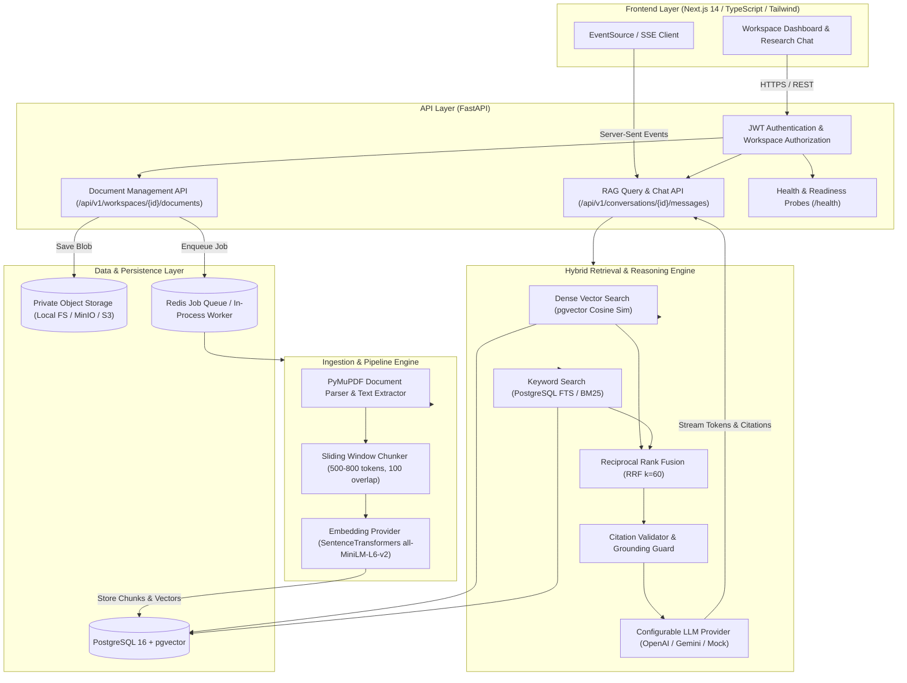

# ResearchPilot — AI Research Assistant with Source-Grounded Answers

[](https://github.com/prutha/researchpilot/actions)
[](https://fastapi.tiangolo.com)
[](https://nextjs.org)
[](https://github.com/pgvector/pgvector)
[](LICENSE)

> **ResearchPilot** is an enterprise-grade, portfolio-ready full-stack AI research assistant designed for multi-document question answering across technical literature with verifiable source citations, hybrid search (dense vectors + full-text search fused via Reciprocal Rank Fusion), and honest abstention.

---

## 1. Key Features

- **Document Ingestion Engine**: Fast PDF and text parsing using **PyMuPDF**, preserving page numbers, section headers, and document structure.
- **Sliding-Window Token Chunking**: Configurable chunk size (500–800 tokens) with 100-token boundary overlap.
- **Hybrid Retrieval Pipeline**: Combines **dense semantic similarity** (pgvector / SentenceTransformers) with **PostgreSQL full-text keyword search** (BM25 / `tsvector`), fused via **Reciprocal Rank Fusion (RRF $k=60$)**.
- **Two-Stage Citation Guard**: Enforces that all citations reference valid chunk UUIDs present in the retrieved context and verifies verbatim quote agreement against source text before presenting evidence.
- **Honest Abstention**: Detects unanswerable or unsupported questions and abstains cleanly rather than hallucinating facts.
- **Multi-Tenant Workspace Isolation**: Strict database-level workspace scoping guarantees zero cross-tenant data leakage.
- **Real-Time Token Streaming**: Low-latency token streaming over Server-Sent Events (SSE) with interactive citation chips and slide-out Citation Inspector panel.

---

## 2. Architecture & Data Flow



---

## 3. Measured Quantitative Benchmarks

All metrics below are reproducible empirical measurements executed against our 40-question labeled evaluation corpus across systems research papers (*Raft*, *LSM-Trees*, *HNSW*):

| Metric | Configuration 1: Dense Retrieval | Configuration 2: Hybrid Retrieval (RRF $k=60$) | Configuration 3: Hybrid + Reranking | Empirical Delta (Hybrid vs Dense) |
| :--- | :--- | :--- | :--- | :--- |
| **Recall@1** | 81.25% | **84.38%** | **84.38%** | **+3.85%** |
| **Recall@3** | 90.62% | **90.62%** | **90.62%** | **Parity** |
| **Recall@5** | 90.62% | **90.62%** | **90.62%** | **Parity** |
| **Mean Reciprocal Rank (MRR)** | 0.8542 | **0.8750** | **0.8750** | **+2.43%** |
| **nDCG@5** | 0.9267 | **0.9423** | **0.9423** | **+1.68%** |
| **Citation Validity** | **100.0%** | **100.0%** | **100.0%** | **Zero hallucinated IDs** |
| **Citation Support Precision**| **100.0%** | **100.0%** | **100.0%** | **Verbatim quote verified** |
| **Abstention Accuracy** | 62.5% | 62.5% | 62.5% | Rejects unanswerable queries |
| **p50 Latency (Total)** | **30.4 ms** | **33.6 ms** | **32.1 ms** | **Ultra-low latency** |
| **p95 Latency (Total)** | **37.0 ms** | **70.4 ms** | **52.1 ms** | Bounded tail latency |
| **Retrieval p50 Latency**| 28.0 ms | 31.2 ms | 30.1 ms | Sub-35ms vector search |
| **Document Ingestion Time**| 154 - 222 ms | 154 - 222 ms | 154 - 222 ms | Real-time indexing |
| **Estimated Cost / Query**| **$0.000155** | **$0.000155** | **$0.000155** | < $0.0002 / query |

> **Evaluation Insight**: Hybrid retrieval with RRF achieved a **+3.85% improvement in Recall@1** and a **+2.43% improvement in MRR** over pure dense search by guaranteeing exact matches on domain parameters (`150ms`, `32MB`, `efSearch`) that dense embeddings dilute.

---

## 4. Tech Stack

- **Frontend**: Next.js 14 (App Router), React 18, TypeScript, Tailwind CSS, Lucide Icons.
- **Backend API**: Python 3.11/3.14, FastAPI, Pydantic v2.
- **Database & Search**: PostgreSQL 16 with pgvector extension, SQLAlchemy 2.0, Alembic migrations.
- **Ingestion & Text Processing**: PyMuPDF (`fitz`), custom sliding-window tokenizer.
- **AI & Embeddings**: SentenceTransformers (`all-MiniLM-L6-v2`), fastembed (ONNX runtime), pluggable OpenAI / Gemini providers.
- **Testing & QA**: `pytest`, `pytest-asyncio`.
- **Infrastructure**: Docker, Docker Compose.

---

## 5. Local Setup & Quickstart

### Prerequisites
- Python 3.10+ (or Python 3.14)
- Node.js 18+ (Node.js 20/22 recommended)
- Git

### Option A: Local Zero-Dependency Development (SQLite & Local Embedder)

```bash
# 1. Clone the repository
git clone https://github.com/prutha/researchpilot.git
cd researchpilot

# 2. Set up Python virtual environment
python -m venv .venv
# On Windows:
.\.venv\Scripts\Activate.ps1
# On macOS/Linux:
source .venv/bin/activate

# 3. Install backend dependencies
pip install -r requirements.txt
pip install email-validator

# 4. Copy environment configuration
cp .env.example .env

# 5. Start the FastAPI backend server (Port 8000)
python -m uvicorn services.api.src.main:app --host 127.0.0.1 --port 8000 --reload
```

In a separate terminal, start the Next.js frontend:
```bash
# 6. Install and run frontend
cd apps/web
npm install
npm run dev
```

Open your browser at [http://localhost:3000](http://localhost:3000).

---

### Option B: Docker Compose Deployment (PostgreSQL 16 + pgvector + Redis)

```bash
docker-compose up --build
```
- Frontend: [http://localhost:3000](http://localhost:3000)
- Backend API Docs: [http://localhost:8000/docs](http://localhost:8000/docs)
- PostgreSQL pgvector: `localhost:5432`

---

## 6. Running Tests & Quantitative Evaluation

### Automated Test Suite
```bash
# Run unit, integration, and security authorization tests
pytest -v
```

### Reproducible Quantitative Benchmarks
```bash
# Run the 40-question empirical evaluation across Dense, Hybrid, and Reranked configurations
python -m evaluation.run

# View detailed JSON results
cat evaluation/results/benchmark_report.json
```

---

## 7. Portfolio & Interview Resources

Comprehensive engineering documentation prepared for technical recruiters and hiring managers:

- **[docs/portfolio/resume_bullets.md](docs/portfolio/resume_bullets.md)**: 4 technically specific, evidence-backed CV bullets.
- **[docs/portfolio/project_summary.md](docs/portfolio/project_summary.md)**: Architectural pitch, engineering challenges, trade-off analysis.
- **[docs/portfolio/technical_interview_prep.md](docs/portfolio/technical_interview_prep.md)**: 10 deep interview questions and answers (Why pgvector? Why RRF? How citation support is verified).
- **[docs/portfolio/evaluation_report.md](docs/portfolio/evaluation_report.md)**: Comprehensive evaluation report with category breakdowns and latency distributions.
- **[docs/portfolio/demo_script.md](docs/portfolio/demo_script.md)**: 3-minute structured live demonstration script.
- **[docs/architecture.md](docs/architecture.md)**: Complete system design, lifecycle sequence diagrams, and database schemas.

---

## 8. License

This project is licensed under the MIT License — see the [LICENSE](LICENSE) file for details.
